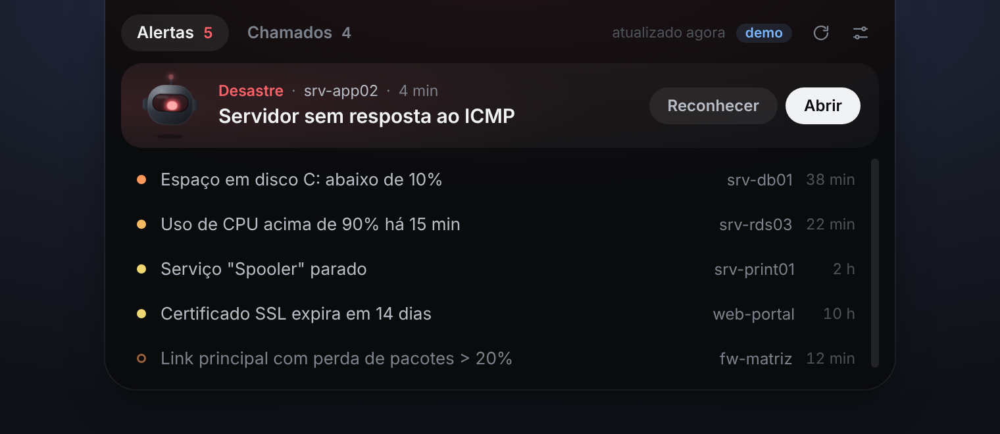
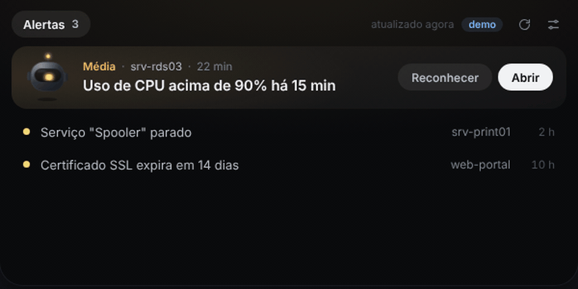

# TopWatch

Uma barrinha discreta no topo da tela que mostra os **alertas do Zabbix** e os **chamados do GLPI**. Passou o mouse, ela abre. Tem alerta grave, a luz muda de cor e a barra diz qual é o host, sem você precisar abrir aba nenhuma.



Feito pra quem trabalha em NOC / suporte de infra e vive alternando entre o Zabbix e o GLPI.

## O que ela faz

- **Luz do TopWatch**: verde quando está tudo calmo, amarela/laranja/vermelha conforme a severidade do pior alerta aberto. Em Alta ou Desastre, um feixe gira em volta da luz.
- **Pílula inteligente**: recolhida, mostra a contagem (`3 alertas · 5 chamados`) ou, se tiver algo grave, direto o que é (`Desastre · srv-app02`).
- **Card de destaque**: ao abrir, o alerta mais grave vem em cima com **Reconhecer** (ack no Zabbix) e **Abrir**. O resto fica numa lista compacta.
- **Vários Zabbix ao mesmo tempo**: cadastre quantos servidores quiser (ex.: um 6.0 com clientes antigos e um 7.0). Os alertas aparecem juntos, cada um com a etiqueta do servidor de onde veio, e o **Reconhecer** vai pro servidor certo. Se um cair, os outros continuam aparecendo.
- **Chamados do GLPI**: os não solucionados, opcionalmente só os atribuídos a você, ordenados por prioridade.
- **Notificação do Windows** para problemas novos de severidade Alta ou Desastre.
- **Vigia**: um robozinho que segue o mouse, olha pra linha sob o cursor, leva susto com alerta novo, fica vermelho no Desastre, acena quando você reconhece e desliga quando está tudo calmo. Clique nele pra cutucar (três vezes rápido e ele dá glitch). Dá pra desligar nas configurações.

  

- **O que mostrar**: alertas e chamados, só alertas ou só chamados.
- **Modo demo** com dados de exemplo, pra ver funcionando sem configurar nada.
- `Ctrl` + `Alt` + `F` fixa a barra aberta; o ícone na bandeja esconde/mostra.

## Instalar

Baixe o instalador `.exe` em [Releases](../../releases). Como o instalador não é assinado digitalmente, o SmartScreen vai mostrar "Editor desconhecido": clique em **Mais informações → Executar assim mesmo**. O instalador é gerado pelo GitHub Actions a partir deste código (veja `.github/workflows/release.yml`).

Ou rode do código:

```bash
git clone https://github.com/victorhugoantonio1/topwatch.git
cd topwatch
npm install
npm start          # ou: npm run demo
```

Pra gerar o instalador localmente: `npm run dist` (sai em `dist/`).

## Configurar

Clique com o botão direito no ícone da bandeja → **Configurações…**

**Zabbix** (5.4 em diante; testado no 6.0 e no 7.0)

1. Em cada Zabbix: *Usuários → Tokens de API → Criar token*.
2. Use um usuário dedicado. Leitura basta pra ver os alertas; o botão **Reconhecer** precisa de permissão de escrita nos hosts.
3. Em **+ Adicionar servidor Zabbix**, dê um nome (ex.: `Zabbix 6`), cole a URL do frontend (ex.: `https://zabbix.empresa.local`) e o token. Repita pra cada servidor.

A versão é detectada sozinha: até o 6.2 o token vai no corpo da requisição, do 6.4 em diante vai no cabeçalho `Authorization`. Se um proxy atrapalhar a detecção, force o modo no campo **Autenticação** daquele servidor. A severidade mínima vale pra todos.

Quem já usava um Zabbix só não precisa refazer nada: a configuração antiga vira o primeiro servidor da lista.

**GLPI** (API REST `apirest.php`, GLPI 9.5/10/11)

1. Ative a API em *Configurar → Geral → API* e confira se há um cliente de API liberado pro seu IP.
2. No seu perfil: *Chaves de acesso remoto → Token da API*.
3. Se o cliente de API exigir, preencha também o **App-Token**.

Servidor interno com certificado autoassinado? Marque "aceitar certificado autoassinado" naquela integração. Use **Testar conexão** antes de salvar.

## Segurança

- Tokens ficam criptografados com o `safeStorage` do Electron (DPAPI do Windows) e nunca voltam em texto puro pra tela.
- A interface roda isolada (`contextIsolation`, `sandbox`, sem Node), com CSP, e todo texto vindo das APIs entra como texto, nunca como HTML.
- Os botões só abrem links que vieram dos próprios dados do Zabbix/GLPI.
- O app só conversa com os servidores que você configurar. Sem telemetria.

## Como funciona

- **Ilha**: uma janela transparente, sem borda e sempre no topo que **deixa o mouse passar** (`setIgnoreMouseEvents` com `forward`). Quando o cursor entra na pílula, ela passa a aceitar cliques e expande; ao sair, volta a ser "fantasma".
- **Coleta**: o processo principal consulta as APIs a cada N segundos (sem CORS, com suporte a certificado autoassinado) e manda o estado pra interface via IPC.
- **Zabbix**: `apiinfo.version` pra descobrir como autenticar, `problem.get` + `trigger.get` (pra pegar os hosts) em todos os servidores em paralelo, e `event.acknowledge` no botão Reconhecer.
- **Carga**: por padrão, uma rodada a cada 60 s (mínimo 30 s). Em cada rodada vai **um `problem.get` por servidor** (até 50 problemas, só campos básicos). O `trigger.get` só sai quando aparece um trigger que o app ainda não conhece, porque os hosts ficam em cache. É mais leve que deixar um dashboard do Zabbix aberto.
- **GLPI**: `initSession` com user_token, depois ativa todas as entidades com subentidades (e troca pra um perfil técnico se o padrão for de autoatendimento), `search/Ticket` filtrando status "não solucionado", sessão reaproveitada e refeita se expirar.

```
main.js            processo principal: janelas, bandeja, coleta, IPC
preload.js         ponte mínima entre interface e processo principal
src/zabbix.js      cliente JSON-RPC do Zabbix (vários servidores, 5.4 a 7.x)
src/glpi.js        cliente REST do GLPI
src/config.js      configurações + tokens criptografados
src/demo.js        dados de exemplo
renderer/          interface da ilha, o Vigia (bot.js) e a tela de configurações
test/              testes dos clientes contra servidores falsos
lab/zabbix/        Zabbix local no Docker + script que simula problemas pela API
```

Testes: `npm test`.

Quer testar contra um Zabbix de verdade sem mexer em produção? O [laboratório](lab/zabbix/README.md) sobe um Zabbix 7.0 no Docker e simula problemas pela API.

## Limitações conhecidas

- Feito e pensado para **Windows**. No Linux a janela não consegue deixar o mouse passar, então o retângulo da ilha fica clicável mesmo recolhido.
- Jogos em tela cheia exclusiva ficam por cima da barra (o que é bom). Em tela cheia "sem bordas", esconda pela bandeja ou pelo atalho.
- O filtro "só chamados atribuídos a mim" pega os chamados em que você é o **técnico**. Chamado atribuído só ao seu grupo não entra; nesse caso, desmarque a opção.

## Licença

[MIT](LICENSE).
